# Entity Relationships & Lifecycles

```mermaid
erDiagram
    ROLE ||--o{ ROLE_LEVEL : "has valid"
    LEVEL ||--o{ ROLE_LEVEL : "has valid"
    ROLE ||--o{ COMPENSATION_BAND : priced_by
    LEVEL ||--o{ COMPENSATION_BAND : priced_by
    LOCATION ||--o{ COMPENSATION_BAND : priced_in
    LOCATION ||--o{ JOB_ASSIGNMENT : at
    ROLE ||--o{ JOB_ASSIGNMENT : as
    LEVEL ||--o{ JOB_ASSIGNMENT : at
    EMPLOYEE ||--|{ JOB_ASSIGNMENT : holds
    EMPLOYEE |o--o{ EMPLOYEE : manages
    EMPLOYEE ||--o{ SALARY_RECORD : paid
    JOB_ASSIGNMENT ||--o{ SALARY_RECORD : under
    COMPENSATION_BAND ||--o{ SALARY_RECORD : compared_to
    FX_RATE ||--o{ SALARY_RECORD : "converts (by currency+month)"
    EMPLOYEE ||--o{ PROMOTION : receives
    EMPLOYEE ||--o{ TENURE : snapshot
    EMPLOYEE ||--o{ PERFORMANCE_EVIDENCE : documented
    COMPARABLE_GROUP ||--|{ COMPARABLE_GROUP_ROLE : includes
    ROLE ||--o{ COMPARABLE_GROUP_ROLE : in
    COMPARABLE_GROUP ||--|{ COMPARABLE_GROUP_MEMBER : contains
    EMPLOYEE ||--o{ COMPARABLE_GROUP_MEMBER : member
    EMPLOYEE ||--o{ ADJUSTMENT_PROPOSAL : subject_of
    COMPARABLE_GROUP ||--o{ ADJUSTMENT_PROPOSAL : basis
    ADJUSTMENT_PROPOSAL ||--|{ APPROVAL_EVENT : trail
    ADJUSTMENT_PROPOSAL ||--o{ PROPOSAL_EVIDENCE : cites
    PERFORMANCE_EVIDENCE ||--o{ PROPOSAL_EVIDENCE : cited_by
    ADJUSTMENT_PROPOSAL |o--o{ SALARY_RECORD : applied_in
```



## Cardinality summary

| Relationship | Cardinality | Optional? | Implemented by |
|---|---|---|---|
| Role ↔ Level | N:M | — | `role_level` bridge (200 rows) |
| (Role, Level, Location, Year) → Band | 1:N versions | — | `compensation_band` effective dates |
| Employee → JobAssignment | 1:N (≥1) | — | `job_assignment.employee_id` |
| Employee → Employee (manager) | N:1 | optional (top of tree) | `employee.manager_id` |
| Employee → SalaryRecord | 1:N | — | monthly snapshot |
| JobAssignment → SalaryRecord | 1:N | — | `salary_record.assignment_id` |
| Band → SalaryRecord | 1:N | — | `salary_record.band_id` |
| Employee → Promotion | 1:N | optional (0..n) | `promotion.employee_id` |
| Employee → Tenure | 1:N (one per year) | — | derived |
| Employee → PerformanceEvidence | 1:N | optional | |
| ComparableGroup ↔ Role | N:M | — | `comparable_group_role` |
| ComparableGroup ↔ Employee | N:M | — | `comparable_group_member` |
| Employee → AdjustmentProposal | 1:N | optional | |
| AdjustmentProposal → ApprovalEvent | 1:N (≥1) | — | append-only |
| AdjustmentProposal ↔ PerformanceEvidence | N:M | optional | `proposal_evidence` |
| AdjustmentProposal → SalaryRecord | 1:N | optional (only when APPLIED) | `salary_record.adjustment_id` |

## Lifecycle states

**Employee**: `ACTIVE → ON_LEAVE → ACTIVE`, `ACTIVE|ON_LEAVE → TERMINATED` (terminal).

**CompensationBand**: `FUTURE → ACTIVE → EXPIRED` driven by `effective_from/to` vs. as-of date. A new
year creates a new band row (new `band_id`, `version+1`); old rows are never edited.

**JobAssignment**: open (`effective_to = null`) → closed when the next assignment starts
(`effective_to = next.effective_from − 1 day`).

**AdjustmentProposal**:
```
DRAFT → SUBMITTED → MANAGER_APPROVED → HR_APPROVED → APPLIED
   │         │              │                │
   └─────────┴──► WITHDRAWN └──► REJECTED ◄──┘
```
Only `HR_APPROVED → APPLIED` may create a salary record with `change_reason = ADJUSTMENT`.
